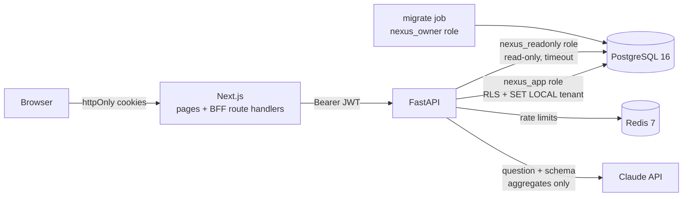

# NexusAI

A multi-tenant business-intelligence SaaS. Companies upload sales data as CSV or Excel, get
dashboards with period comparisons and anomaly detection, export PDF and Excel reports, and
ask questions in plain English ("Which products generated the highest revenue last
quarter?").

The engineering focus is **isolation and safety**: each company's rows are separated by
PostgreSQL Row-Level Security rather than application code alone, and SQL written by an AI
model never gets unrestricted database access. It passes through five independent layers,
each of which is tested on its own.

**Stack:** Python 3.12 · FastAPI · SQLAlchemy 2 · Alembic · Pydantic v2 · Pandas · sqlglot ·
PostgreSQL 16 · Redis 7 · Next.js 16 · TypeScript · Tailwind · Recharts · Docker ·
GitHub Actions · Anthropic Claude API

## Status

| Area | Status |
|---|---|
| Company (tenant) sign-up creating its first OWNER; sign-in by workspace + email | Built and tested |
| Argon2id password hashing, constant-time path for unknown accounts | Built and tested |
| 15-minute JWT access tokens; opaque refresh tokens stored hashed, rotated on every use, whole family revoked on reuse | Built and tested |
| RBAC: OWNER > ADMIN > ANALYST > VIEWER, role re-read from the DB on each request, nobody can grant a role at or above their own | Built and tested (full permission matrix) |
| Invitations (single-use, expiring, superseded), role changes, deactivation | Built and tested. No email delivery: the inviter copies a link |
| Append-only audit log written in the same transaction as the action | Built and tested |
| **Tenant isolation in PostgreSQL**: RLS on every tenant table, per-transaction `SET LOCAL`-style context, non-owner app role, composite foreign keys | Built and tested, incl. queries that "forget" the WHERE clause |
| CSV/Excel upload: Pandas ETL, header aliases, row-level validation with row/column/reason, whole-file rejection over 20% bad rows | Built and tested (20k-row upload in tests, 100k in the benchmark) |
| Dashboards: KPIs vs previous period, time series, breakdowns, new vs returning customers, filters | Built and tested (checked by hand and against a Pandas oracle) |
| Anomaly detection (rolling median + MAD) | Built and tested |
| **Safe AI query engine**: validator, read-only role, read-only transaction + timeout, RLS, row cap, per-tenant rate limit | Built and tested, including a scripted "malicious model" |
| Natural-language questions via Claude (structured output, server-side refusal fallback) | Built; tested with a scripted model. **Not yet run against the live Claude API** (no key in the build environment) |
| SQL console for analysts (same safety layers) | Built and tested |
| AI-written summaries and anomaly explanations from aggregates only, with a template fallback | Built and tested (template path); LLM path tested with a scripted model |
| PDF report and Excel workbook export | Built and tested (PDF content not visually regression-tested) |
| Next.js web app: landing, sign-in/up, invite acceptance, dashboard, data, Ask AI, team & audit | Built; lint + type-check + build in CI; flows checked by hand in a browser, no automated UI tests |
| Backend-for-frontend: tokens only in httpOnly cookies, transparent refresh, CSRF header on writes | Built; checked by hand and by the smoke script |
| Dockerfiles, full-stack docker compose with a separate migration step | Built; **first run happens in CI** (no Docker on the development machine) |
| CI: ruff, mypy (strict), pytest on PostgreSQL 16 + Redis 7, migration round-trip, web lint/types/build, Docker end-to-end smoke test | Built |
| Performance benchmark (`docs/performance.md`) | Built and run; it found and fixed two real problems (below) |
| Hosted deployment (cloud provider, domain, TLS) | **Not done.** Images are ready; no environment has been set up |
| Password reset, MFA, SSO, email sending | Not built |
| Data models beyond sales lines (e.g. custom schemas per upload) | Not built |

## Architecture



Three database roles, three levels of trust:

| Role | Used by | Can |
|---|---|---|
| `nexus_owner` | Alembic only (a one-off container) | Owns the schema |
| `nexus_app` | The API | Read/write tenant tables; **subject to RLS** (not owner, not superuser, no BYPASSRLS); no UPDATE/DELETE on the audit log |
| `nexus_readonly` | AI and SQL-console queries | SELECT on the `sales` analytics view only; read-only transactions; 5 s statement timeout; `set_config()` revoked |

### Tenant isolation with Row-Level Security

Every tenant-scoped table has a `tenant_id` and the same policy:

```sql
CREATE POLICY tenant_isolation ON sales_records
    USING      (tenant_id = (SELECT app_current_tenant()))
    WITH CHECK (tenant_id = (SELECT app_current_tenant()));
```

Each request runs in one transaction that starts with
`SELECT set_config('app.tenant_id', '<uuid>', true)`, the parameterisable form of
`SET LOCAL`: the value disappears at commit or rollback, so a pooled connection never
carries one tenant into the next request. `app_current_tenant()` returns NULL when nothing
is set, so a missing context matches no rows and rejects every write (fail closed).

`tests/test_rls.py` connects as the app role and runs deliberately buggy SQL: `SELECT`,
`UPDATE` and `DELETE` without a WHERE clause, inserts for another tenant, moving a row to
another tenant, a foreign key into another tenant. All are confined or rejected by the
database. As a mutation check, running the API as the owner role (which bypasses RLS) makes
the HTTP isolation tests fail: the isolation comes from the database, not from WHERE
clauses (the application code has none).

The only deliberate cross-tenant lookup is sign-in turning a workspace name into a tenant
id, done by one `SECURITY DEFINER` function that returns only that id.

### AI queries never get unrestricted database access

A question is sent to the model with the analytics schema; the model returns a SQL *draft*.
The draft is then treated like any untrusted input:

1. **Validator** (`app/ai/sql_guard.py`, sqlglot): exactly one `SELECT`; only the `sales`
   view; no schema-qualified names; an allow-list of side-effect-free functions (so no
   `pg_sleep`, `set_config`, `pg_read_file`, `dblink`, ...); no `INTO`, locks, DML or DDL.
   The database executes the SQL **re-rendered from the validated tree**, never the
   original text.
2. **Role:** `nexus_readonly` can read only the analytics view; even an unvalidated
   `SELECT * FROM users` fails with *permission denied*.
3. **Transaction:** `READ ONLY` with `SET LOCAL statement_timeout`.
4. **RLS:** the transaction is bound to the caller's tenant.
5. **Limits:** a row cap outside the query, and a per-tenant rate limit in Redis.

Every attempt, allowed or blocked, is stored in the query history and the audit log.
Summaries and anomaly explanations send the model aggregate figures only, never raw rows.

### Authentication

- Passwords: Argon2id. Unknown users are verified against a dummy hash so timing does not
  reveal which accounts exist.
- Access token: 15-minute HS256 JWT (issuer, audience, type checked). The role inside it is
  informational: authorization re-reads the user row on every request, so a demotion or
  deactivation applies immediately.
- Refresh token: `<tenant>.<256 random bits>`, stored as SHA-256. Each use marks it used and
  issues a new one in the same *family* (`SELECT ... FOR UPDATE` serialises concurrent
  refreshes). Presenting a used token again means it was copied, so the whole family is
  revoked and audited.
- In the browser, both tokens live only in httpOnly cookies managed by Next.js route
  handlers (backend-for-frontend); state-changing calls need a custom header (CSRF).
  Invitation tokens travel in the URL fragment, which is never sent to servers.

## Performance

From `python scripts/benchmark.py` (two tenants x 100,000 sales lines, in-process API,
developer laptop; full table in [docs/performance.md](docs/performance.md)):

| | |
|---|---|
| Upload 100k rows over HTTP (parse, validate, insert) | 5.2 s (~19k rows/s); validation alone ~0.9 s |
| Full-year dashboard (11 queries) | p50 360 ms |
| Dashboard, one quarter + region | p50 61 ms |
| SQL console query (validate + read-only execute) | p50 32 ms |
| RLS-filtered aggregate vs explicit `WHERE tenant_id` | 22.8 ms vs 22.5 ms |

The benchmark changed the code twice:

1. The first RLS policy called `current_setting()` once per row and could not use the
   tenant index (67 ms vs 22 ms). Migration 0004 wraps it as `(SELECT ...)`, an InitPlan
   evaluated once: now at parity.
2. `COUNT(DISTINCT ...)` sorted text keys with the linguistic collation and spilled to disk.
   `COLLATE "C"` gives the same counts about 5x faster; the full-year dashboard went from
   731 ms to 360 ms.

Known slow spot: Excel export of tens of thousands of lines takes seconds (openpyxl).

## Running it

### Docker (everything)

```bash
docker compose up --build
```

Open http://localhost:3000, create a workspace, and upload a file. Sample data:

```bash
cd api && python -m app.sample_data --rows 5000 --out sample-sales.csv
```

To enable plain-English questions and AI summaries, set `NEXUS_ANTHROPIC_API_KEY` before
`docker compose up`. Without it, the SQL console, dashboards and template summaries work.

### Without Docker (development)

```bash
cd api
python -m venv .venv && .venv/Scripts/activate   # or source .venv/bin/activate
pip install -e ".[dev,local]"
python scripts/dev_db.py --env      # embedded PostgreSQL 16, roles, migrations, api/.env
uvicorn app.asgi:app --reload --port 8000
```

```bash
cd web
npm install
npm run dev                         # http://localhost:3000, expects the API on :8000
```

## Tests

```bash
cd api
pytest                # 147 tests on a real PostgreSQL 16 (1 needs Redis and runs in CI)
ruff check . && ruff format --check . && mypy
python scripts/benchmark.py
```

```bash
cd web && npm run lint && npm run typecheck && npm run build
bash scripts/smoke.sh  # against a running docker compose stack
```

| Suite | What it proves |
|---|---|
| `test_rls.py` | Tenant A cannot read, update, delete or insert tenant B's rows with WHERE-less SQL; context does not leak across pooled connections; the app role cannot bypass RLS; the audit log is append-only |
| `test_auth.py` | Sign-up, login, hashing, token expiry and forgery, refresh rotation, reuse detection revoking the family |
| `test_rbac.py` | Permission matrix for every role x endpoint; no self-promotion; demotion and deactivation take effect immediately; cross-tenant ids are 404 |
| `test_invitations_audit.py` | Single-use, expiring, superseded and cross-tenant-tampered invitations; audit trail contents and pagination |
| `test_ingest.py`, `test_datasets.py` | Header aliases, number/date/status normalisation, row-level errors, duplicate handling, rejection threshold, Excel input, isolation of uploads |
| `test_analytics.py`, `test_reports.py` | KPIs by hand and against a Pandas oracle, filters, anomaly detection, Excel figures equal the dashboard |
| `test_sql_guard.py`, `test_ai.py`, `test_ratelimit.py` | 25 attack queries rejected; a malicious model's output blocked and logged; the read-only role holds without the validator; timeouts, row caps, rate limits |

## API

Interactive docs at `/docs` when the API is running. Main routes (all under `/api/v1`):

| Route | Minimum role |
|---|---|
| `POST /auth/signup`, `/auth/login`, `/auth/refresh`, `/auth/logout`, `/auth/invitations/accept` | public |
| `GET /me`, `/users`, `/datasets`, `/analytics/overview`, `/analytics/filters`, `/reports/sales.{pdf,xlsx}`; `POST /ai/summary` | VIEWER |
| `POST /datasets`, `/ai/query`, `/ai/sql`; `GET /ai/history` | ANALYST |
| `PATCH /users/{id}/role`, `POST /users/{id}/deactivate`, `/invitations`, `DELETE /datasets/{id}`, `GET /audit-logs` | ADMIN |

## Project layout

```
api/            FastAPI service
  app/          routers, auth, RBAC, ingestion, analytics, reports, ai/ (guard, executor, LLM)
  migrations/   Alembic: schema, RLS policies, grants
  tests/        pytest on real PostgreSQL
  scripts/      dev_db.py (embedded Postgres), benchmark.py
web/            Next.js app and BFF route handlers
db/init/        database roles and hardening (run by docker compose and the tests)
scripts/        smoke.sh end-to-end check
docs/           performance.md
```

## Licence

MIT
